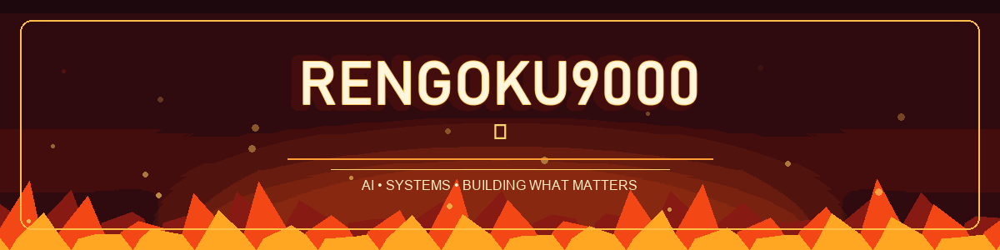

### 🔥 Kunal | AI & ML Engineer in the making

**Building intelligent systems that work in the real world.**

[LinkedIn](https://www.linkedin.com/in/kunal-991760334/) · [GitHub](https://github.com/Rengoku9000)

---

### About me

I’m **Kunal**, pursuing a **BE in Artificial Intelligence and Machine Learning** at **BMS Institute of Technology and Management, Bengaluru**. I enjoy bringing AI models together with reliable software systems, from voice agents and retrieval augmented generation to offline mapping and mesh networking.

- 🔥 Current interests: **deep learning, LLMs, agent systems, and offline first distributed software**
- 🎓 Current CGPA: **8.90**
- 🤝 Open to collaborating on applied AI and systems projects

### Selected projects

| Project | What I built |
| --- | --- |
| **[SecureMesh](https://github.com/Rengoku9000/Secure-Mesh-V1)** | A local first disaster response platform that synchronizes signed incident records between enrolled nodes over encrypted QUIC. |
| **[DRUGVISTA](https://github.com/Rengoku9000/Drugvista)** | A pharmaceutical research copilot with a four stage reasoning flow and FAISS based document retrieval. |
| **Jarvis OS & F.R.I.D.A.Y.** *(private repository)* | A voice driven assistant with LiveKit agents, MCP tools, browser automation, and a Tauri desktop dashboard. |
| **[PulseGuard AI](https://github.com/Rengoku9000/Pulse-AI)** | A healthcare triage prototype with a React command center, FastAPI backend, RAG retrieval, and operational monitoring. |
| **[GAN Anime Face Generator](https://github.com/Rengoku9000/GAN-Anime-face-generator)** | A PyTorch DCGAN that generates anime style faces from latent noise. |
| **[Ship-Pro](https://github.com/Rengoku9000/Ship-Pro)** | A B2B shipping estimator with Spring Boot and React dashboards for sellers and customers. |

### Toolkit

**Languages:** Python · JavaScript · Java · C · C++ · SQL · Rust  
**AI & data:** PyTorch · FAISS · Sentence Transformers · NumPy · Pandas · LLM orchestration  
**Apps & systems:** React · FastAPI · Tauri · Three.js · Playwright · Docker · AWS

### Highlights

- 🏆 National finalist, **Techfest AWS ImpactX Challenge** at IIT Bombay for DRUGVISTA
- 🏆 Finalist, **Code of Honour 2.0** at PES University
- ⚡ Built and demonstrated SecureMesh for **Smart India Hackathon**

---

**Set your heart ablaze. Keep building. 🔥**

